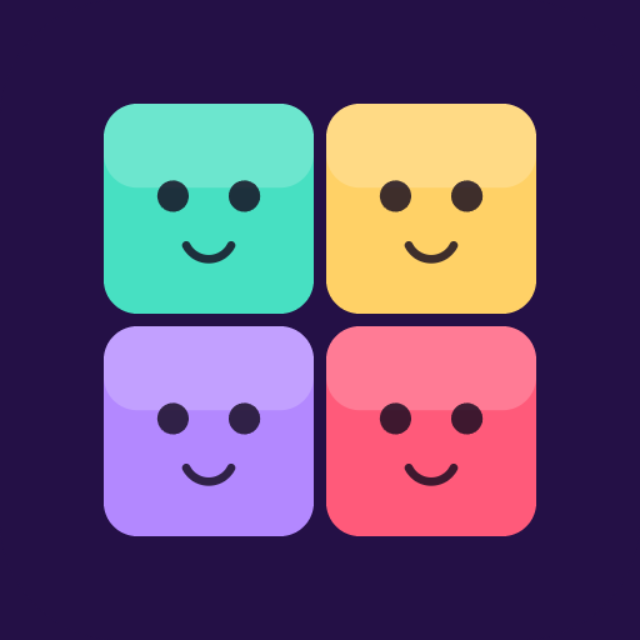

# TETROMOJI



A tiny bitmoji-faced Tetris, built as a Snapchat Web Lens.

## Play

Drag to slide the falling piece, tap to rotate, swipe down to slam it into place. Clear lines,
climb the leaderboard.

## Local run

```bash
npm install
npm start        # builds to dist/ and serves it, prints the local URL
```

## Snapchat Lens packaging

```bash
npm run build
npm run lens -- 1   # -> tetromoji-lens-v1.zip, checked against Snap's Web Lens requirements
```

## Testing

```bash
npm test
```

## Architecture

- `src/game/` — pure game logic: `pieces.ts` (tetromino shapes + a 7-bag randomizer),
  `physics.ts` (collision, line clearing, scoring), `state.ts` (the single `GameState`),
  `loop.ts` (`step(state, input, dt, hooks)` — side-effect-free beyond mutating `state`),
  `input.ts` (drag-to-slide / tap-to-rotate / swipe-to-drop gesture recognition).
- `src/render/draw.ts` — all Canvas 2D drawing, including the procedural bitmoji-style faces.
- `src/audio/sound.ts` — procedural Web Audio sound effects and an ambient pad, no audio files.
- `src/snap/profile.ts` — Snapchat leaderboard + Bitmoji + storage, with a `localStorage`
  fallback outside Snapchat.
- `src/main.ts` — the only file touching the DOM: canvas fit, pointer events, the game loop.

`assets/bg.jpg` is the only art asset — a generated backdrop drawn behind the procedural board
and pieces. `assets/icon.png` is the separate Lens Icon upload. Everything else is drawn or
synthesized in code.
